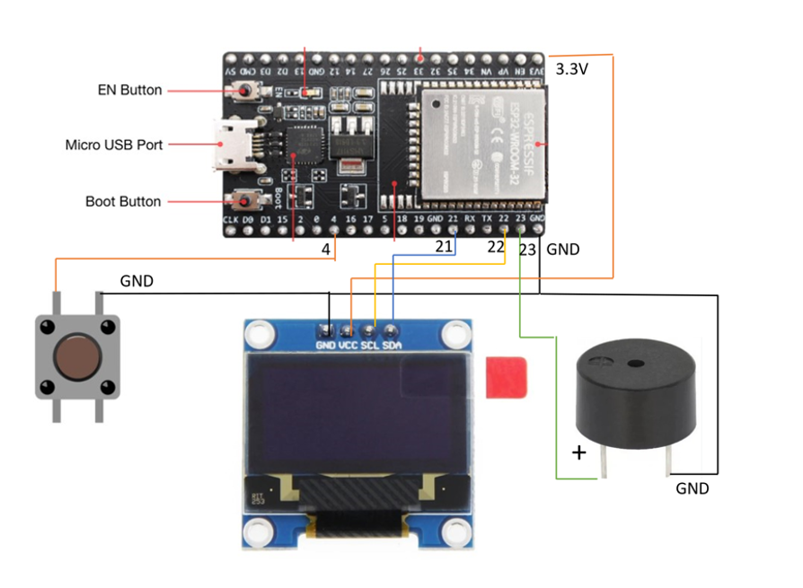

# The kit

An ESP32 board, a small screen, one button and a buzzer on a breadboard. Built by hand in about half an hour
([assembly video](https://www.youtube.com/watch?v=Jap-4eeCaNw), Hebrew), it starts up running a Flappy game.

## Parts

| Part | What it is |
|---|---|
| ESP32 DevKit (30 pins, CP210x USB chip, micro-USB) | the computer: two cores at 240 MHz, 4 MB flash, WiFi and Bluetooth |
| 0.96" OLED screen, SSD1306, I2C, 4 pins | 128 x 64 white dots |
| Push-button (4 legs) | the one button |
| Buzzer (passive, 2 legs, marked +) | sound |
| Breadboard and jumper wires | no soldering |
| Micro-USB cable **that carries data** | power and programming; charge-only cables look the same and do not work |

## Wiring

<!-- pins:start (checked by tests/test_pins.py against lib/SingleButtonKit) -->
| From | To ESP32 pin |
|---|---|
| Screen GND | GND |
| Screen VCC | 3V3 |
| Screen SCL | 22 |
| Screen SDA | 21 |
| Button, one leg | 4 |
| Button, the leg across from it | GND |
| Buzzer + | 23 |
| Buzzer, other leg | GND |
<!-- pins:end -->

Rules that keep the kit safe:
* **Unplug USB before moving any wire.**
* The screen takes **3V3, never 5V** (some screens survive 5V, some do not).
* Nothing should ever get warm. If something does: unplug, then check for a wire from 3V3 or 5V straight to GND.

## How the program sees it

* **Screen**: I2C bus on SDA 21 / SCL 22 at 400 kHz, address 0x3C (some screens 0x3D; the library tries both).
* **Button**: pin 4 as `INPUT_PULLUP`. Released reads HIGH (1); pressed connects it to GND and reads LOW (0).
  The library turns that into `button.pressed()` / `isDown()` and removes contact bounce.
* **Buzzer**: a tone (PWM square wave) on pin 23 with `tone()`; the library wraps it as `beep()` and `playTune()`.
* **BOOT button** (on the ESP32 board, right of the USB socket): held while uploading, forces "download mode"
  if the automatic switch fails. **EN** (left): restarts the program.

## Free pins for more parts

13, 14, 16, 17, 18, 19, 25, 26, 27, 32, 33; input-only 34, 35, 36, 39. Avoid 0, 2, 5, 12, 15 (start-up pins), 1 and 3
(USB serial), 6-11 (flash). Recipes: the `kit-hardware` skill.

## Proving it works

`examples/kit_check` + `python scripts/kit_doctor.py --listen 20` (the chat does this for you in the journey's phase 3).
